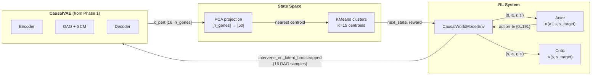

# Phase 2: Joint VAE + PPO Training — Detailed Walkthrough

> **Entry point:** `scripts/run_phase2.py` &rarr; `training/train_joint.py:train_joint()`
> **Prerequisite:** Phase 1 checkpoint at `checkpoints/phase1_best.pt`
> **Default config:** `configs/default.yaml` (phase2 section)

---

## 1. Architecture Overview

Phase 2 jointly trains an **RL policy** to navigate cell state space and **fine-tunes the CausalVAE** world model, with the policy focusing VAE updates on the latent programs it actually uses.



### Component summary

| Component | File | Input | Output |
|-----------|------|-------|--------|
| **Actor** | rl/actor_critic.py | `[s_emb, s_target]` (100D) | Categorical dist over 192 actions |
| **Critic** | rl/actor_critic.py | `[s_emb, s_target]` (100D) | Scalar value V(s, s_target) |
| **Environment** | rl/env.py | action (int) | (next_state, reward, done, info) |
| **PPO** | rl/ppo.py | rollout buffer | actor/critic loss updates |
| **train_joint** | training/train_joint.py | config + Phase 1 ckpt | trained policy + fine-tuned VAE |

---

## 2. State and Action Spaces

### State space: KMeans clusters on PCA

```
Raw expression x [B, 2000]
    → PCA projection [B, 50]
        → KMeans (K=15) → cluster_id ∈ {0..14}
        → centroids [15, 50] — used as state embeddings
```

Cells are embedded into 50D PCA space, then grouped into 15 clusters. Each cluster centroid serves as the **state embedding** passed to the actor/critic networks.

### Action space: latent_idx × intervention_value

```
action ∈ {0, 1, ..., 191}

Decoding:
    latent_idx = action // 3      →  which latent program [0..63]
    val_idx    = action % 3       →  intervention intensity
    pert_value = [0.0, -1.0, -2.0][val_idx]
                  ↑      ↑       ↑
               knockout  mild KD  strong KD
```

| Action | Latent | Value | Meaning |
|--------|--------|-------|---------|
| 0 | 0 | 0.0 | Knock out latent program 0 |
| 1 | 0 | -1.0 | Mild knockdown of program 0 |
| 2 | 0 | -2.0 | Strong knockdown of program 0 |
| 3 | 1 | 0.0 | Knock out program 1 |
| ... | ... | ... | ... |
| 191 | 63 | -2.0 | Strong knockdown of program 63 |

---

## 3. Actor and Critic Networks

Both are goal-conditioned: they take `[s_emb, s_target_emb]` (concatenated, 100D) as input.

```
Actor:  Linear(100, 128) → ReLU → Linear(128, 128) → ReLU → Linear(128, 192) → Categorical
Critic: Linear(100, 128) → ReLU → Linear(128, 128) → ReLU → Linear(128, 1) → scalar V(s)
```

**Goal conditioning**: The target state embedding is concatenated with the current state, so the policy learns *which actions move toward a specific target*, not just *which actions are globally good*.

---

## 4. Environment: CausalWorldModelEnv

The environment uses the CausalVAE as a **learned simulator**. Each step:

```
┌─────────────────────────────────────────────────────────────────┐
│ env.step(action)                                                │
│                                                                 │
│  1. Decode action → (latent_idx, pert_value)                    │
│                                                                 │
│  2. VAE.intervene_on_latent_bootstrapped(                       │
│         current_epsilon, latent_idx, pert_value, n_samples=16)  │
│     → all_x_hat [16, 1, n_genes]                               │
│     → all_z_post [16, 1, d]                                    │
│                                                                 │
│  3. For each of 16 predictions:                                 │
│     x̂ → PCA → nearest centroid → state_id                      │
│     → s_next_samples = [s₁, s₂, ..., s₁₆]                     │
│                                                                 │
│  4. Consensus: next_state = majority_vote(s_next_samples)       │
│                                                                 │
│  5. Reward = pessimistic(s_current, s_next_samples, s_target)   │
│                                                                 │
│  6. Update epsilon ← mean(all_z_post)  (for next step)         │
│                                                                 │
│  7. done = (step_count ≥ 3) or (next_state == target)          │
│                                                                 │
│  Return: (next_state, reward, done, info)                       │
└─────────────────────────────────────────────────────────────────┘
```

### Bootstrapped state assignment

The environment samples **16 different DAGs** and makes a separate prediction for each. This produces 16 (possibly different) next-state assignments. The **majority vote** determines the actual next state, providing robustness to DAG uncertainty.

### Reward function

The reward has four components:

```
r = r_goal + r_shaping + r_cost  (computed per DAG sample)
→ aggregate pessimistically across samples
→ add exploration bonus

r_total = (r_mean − α·r_std) + β·entropy(state_distribution)
```

| Component | Formula | Purpose |
|-----------|---------|---------|
| **Goal** | `+1.0` if `s_next == target`, else `0.0` | Direct objective |
| **Potential shaping** | `γ·φ(s_next) − φ(s_current)` where `φ(s) = exp(−‖c_s − c_target‖² / σ²)` | Smooth guidance toward target |
| **Step cost** | `−λ_cost` (default −0.1) | Encourage shorter paths |
| **Pessimism** | `mean − α·std` across 16 DAG samples | Risk-averse under DAG uncertainty |
| **Exploration** | `β·entropy(next_state_distribution)` | Encourage diverse outcomes |

**Intuition**: Under DAG uncertainty (16 samples disagree on the next state), the agent prefers actions with *consistent* outcomes (low std) and avoids actions where the world model is uncertain.

---

## 5. PPO Algorithm

Standard PPO with GAE, adapted for goal-conditioned policies.

### Rollout collection

```
For each iteration:
    1. Sample control cell → encode → epsilon
    2. Pick (start_state, target_state)
    3. Run episode (max 3 steps):
       action, log_prob, value = ppo.select_action(s_emb, target_emb)
       next_state, reward, done, info = env.step(action)
       ppo.store_transition(s_emb, target_emb, action, reward, done, log_prob, value)
    4. Accumulate step_count
```

### PPO update (every 2048 steps)

```
1. Bootstrap terminal value: V(s_last, target)
2. Compute returns and GAE advantages:
   δ_t = r_t + γ·V(s_{t+1}) − V(s_t)
   A_t = Σ_{l=0}^{T-t} (γλ)^l · δ_{t+l}
   R_t = A_t + V(s_t)

3. For 4 epochs, for each minibatch (size 64):
   a. Normalize advantages: A = (A − mean) / (std + ε)
   b. Actor loss:
      ratio = exp(log_π_new − log_π_old)
      L_actor = −min(ratio·A, clip(ratio, 0.8, 1.2)·A)
   c. Entropy bonus: L_entropy = −entropy_coeff · H(π)
   d. Critic loss: L_critic = value_coeff · MSE(V, R)
   e. Clip gradients (max_norm=0.5), step optimizers

4. Clear rollout buffer
```

### PPO hyperparameters

| Parameter | Value | Role |
|-----------|-------|------|
| `gamma` | 0.99 | Discount factor |
| `gae_lambda` | 0.95 | GAE bias-variance tradeoff |
| `clip_epsilon` | 0.2 | PPO clipping range |
| `entropy_coeff` | 0.01 | Exploration bonus |
| `value_coeff` | 0.5 | Critic loss scaling |
| `max_grad_norm` | 0.5 | Gradient clipping |
| `policy_lr` | 3e-4 | Actor learning rate |
| `critic_lr` | 1e-3 | Critic learning rate |
| `n_epochs_per_update` | 4 | PPO epochs per rollout |
| `ppo_batch_size` | 64 | Minibatch size |
| `n_steps_per_rollout` | 2048 | Steps before update |

---

## 6. VAE Fine-Tuning with Policy Relevance

Every 10 iterations, the VAE is updated with **policy relevance upweighting** — latent programs that the RL policy uses frequently get higher perturbation loss weight.

### Policy relevance mechanism

```
Track action_counts[latent_idx] across all RL steps

For each latent i:
    freq[i] = action_counts[i] / total_actions
    weight[i] = 1.0 + (upweight_max − 1.0) × freq[i] × latent_dim
                                    ↑                        ↑
                              default 3.0                   64

Then:  pert_loss *= weight[latent_for_this_gene]
```

**Example**: If latent 5 was used in 5% of all actions:
```
weight[5] = 1.0 + (3.0 − 1.0) × 0.05 × 64 = 1.0 + 6.4 = 7.4×
```

Latent 5's perturbation consistency loss is scaled by **7.4x**, so the VAE concentrates its limited update budget on improving predictions for policy-relevant programs.

### VAE update flow

```
┌───────────────────────────────────────────────────────┐
│ Every 10 iterations:                                  │
│                                                       │
│  1. Compute latent_weights from action_counts         │
│                                                       │
│  2. Sample interventional batch (64 ctrl + 64 pert)   │
│                                                       │
│  3. Identify responsible latent via D†:               │
│     get_latent_for_gene_v2(dx, A_probe)               │
│                                                       │
│  4. pert_loss = pert_consistency_loss_v2(ctrl, pert, dx)│
│     pert_loss *= latent_weights[responsible_latent]    │
│                                                       │
│  5. Forward pass on 64 control cells:                 │
│     total_loss = recon + β·KL + λ·pert + DAG terms    │
│                                                       │
│  6. Backward + clip_grad_norm(1.0) + step             │
│                                                       │
│  VAE lr = 1e-4 (10× lower than Phase 1)              │
└───────────────────────────────────────────────────────┘
```

### Why fine-tune the VAE?

The Phase 1 VAE was trained on *all* perturbations equally. But the RL policy only cares about a subset of latent programs (those useful for navigating between states). Fine-tuning concentrates model accuracy on these programs, creating a **virtuous cycle**:

```
RL discovers useful latents → VAE improves those latents → better predictions → better RL
```

---

## 7. Cell Re-Clustering

Every 1000 iterations, cells are re-clustered:

```
1. Run KMeans(K=15) on PCA embeddings of all cells
2. Update env.state_centroids with new centroids
3. Update cluster_labels for control cells
```

**Why?** As the VAE representation changes during fine-tuning, the PCA projections shift. Re-clustering ensures the discrete state space remains aligned with the actual cell population structure.

---

## 8. Episode Lifecycle — Complete Example

```
Iteration 500:

  1. SAMPLE: Pick control cell #4231
     → encode → epsilon_start [1, 64]
     → cluster assignment → start_state = 3

  2. TARGET: Randomly pick target_state = 11 (≠ 3)

  3. EPISODE:
     Step 1: Actor outputs action=47 (latent 15, pert_value=-2.0)
             → 16 DAG samples → states: [7,7,7,8,7,7,7,7,7,7,7,7,8,7,7,7]
             → majority: state 7
             → reward: r_mean=0.12, r_std=0.04 → pessimistic=0.08, +explore=0.02 → 0.10
             → epsilon updated to mean(z_post)

     Step 2: Actor outputs action=142 (latent 47, pert_value=-1.0)
             → states: [11,11,10,11,11,11,11,11,11,11,10,11,11,11,11,11]
             → majority: state 11 == target!
             → reward: r_mean=0.85 → pessimistic=0.78, +explore=0.01 → 0.79
             → done=True (reached target in 2 steps)

  4. BUFFER: Store 2 transitions for PPO

  Episode reward: 0.10 + 0.79 = 0.89, length: 2
```

---

## 9. Training Schedule

```
Iteration: 1                                                50000
            │──────────────────────────────────────────────────│
            │                                                  │
            │  RL: Every iteration                             │
            │    Sample cell, run episode (1-3 steps)          │
            │    Accumulate in PPO buffer                      │
            │                                                  │
            │  PPO Update: Every 2048 accumulated steps        │
            │    (~680 episodes worth)                         │
            │    4 epochs × minibatch=64                       │
            │                                                  │
            │  VAE Update: Every 10 iterations                 │
            │    Sample interventional batch                   │
            │    Policy-weighted pert loss                     │
            │    lr=1e-4 (conservative)                        │
            │                                                  │
            │  Re-cluster: Every 1000 iterations               │
            │    KMeans on PCA, update env centroids            │
            │                                                  │
            │  Checkpoint: Every 100 iterations                │
            │    Save policy + VAE + centroids                 │
            │                                                  │
            └──────────────────────────────────────────────────┘
```

---

## 10. Checkpoints and Outputs

### Files produced

| File | Contents | When |
|------|----------|------|
| `checkpoints/phase2_policy_latest.pt` | Actor + Critic weights + optimizer states | Every 100 iters |
| `checkpoints/phase2_vae_latest.pt` | VAE state_dict + centroids + gene_names + config | Every 100 iters |
| `checkpoints/phase2_policy_final.pt` | Final policy checkpoint | End of training |
| `checkpoints/phase2_vae_final.pt` | Final VAE checkpoint | End of training |
| `logs/phase2_training.csv` | Per-100-iter metrics | Throughout |

### VAE checkpoint contents

```python
{
    'iteration': int,
    'model_state_dict': ...,
    'vae_optimizer': ...,
    'state_centroids': np.array [15, 50],
    'cluster_labels': np.array [n_cells],
    'gene_names': list,
    'config': dict,
}
```

---

## Appendix: Default Phase 2 Hyperparameters

From `configs/default.yaml`:

| Parameter | Value | Description |
|-----------|-------|-------------|
| `n_iterations` | 50000 | Total training iterations |
| `vae_lr` | 1e-4 | VAE fine-tuning learning rate |
| `policy_lr` | 3e-4 | Actor learning rate |
| `critic_lr` | 1e-3 | Critic learning rate |
| `gamma` | 0.99 | Discount factor |
| `gae_lambda` | 0.95 | GAE lambda |
| `clip_epsilon` | 0.2 | PPO clipping range |
| `entropy_coeff` | 0.01 | Entropy bonus weight |
| `value_coeff` | 0.5 | Critic loss scale |
| `max_grad_norm` | 0.5 | Gradient clipping |
| `n_epochs_per_update` | 4 | PPO epochs per rollout |
| `n_steps_per_rollout` | 2048 | Steps before PPO update |
| `ppo_batch_size` | 64 | Minibatch size |
| `max_episode_steps` | 3 | Max steps per episode |
| `n_cell_states` | 15 | Number of KMeans clusters |
| `alpha_pessimism` | 1.0 | Pessimism coefficient |
| `beta_explore` | 0.1 | Exploration bonus weight |
| `lambda_cost` | 0.1 | Per-step cost |
| `phi_sigma` | 1.0 | Potential shaping sigma |
| `policy_relevance_upweight` | 3.0 | Max upweight factor |
| `vae_update_every` | 10 | VAE update frequency |
| `recluster_every` | 1000 | Re-clustering frequency |
