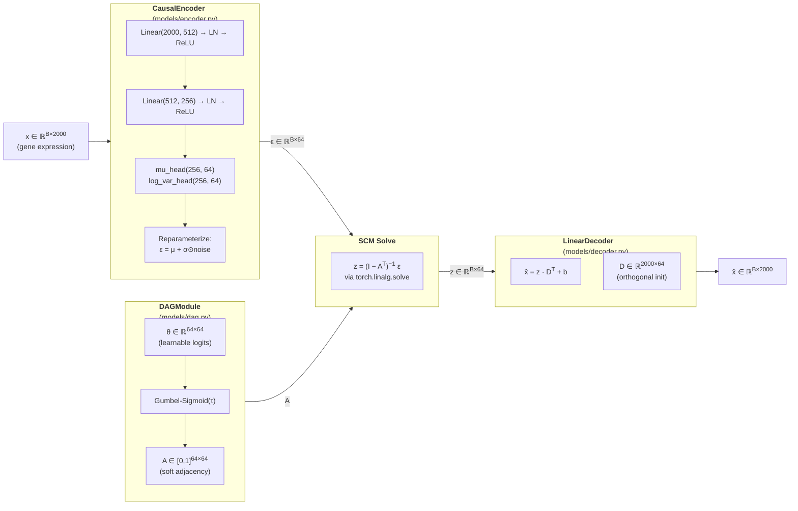
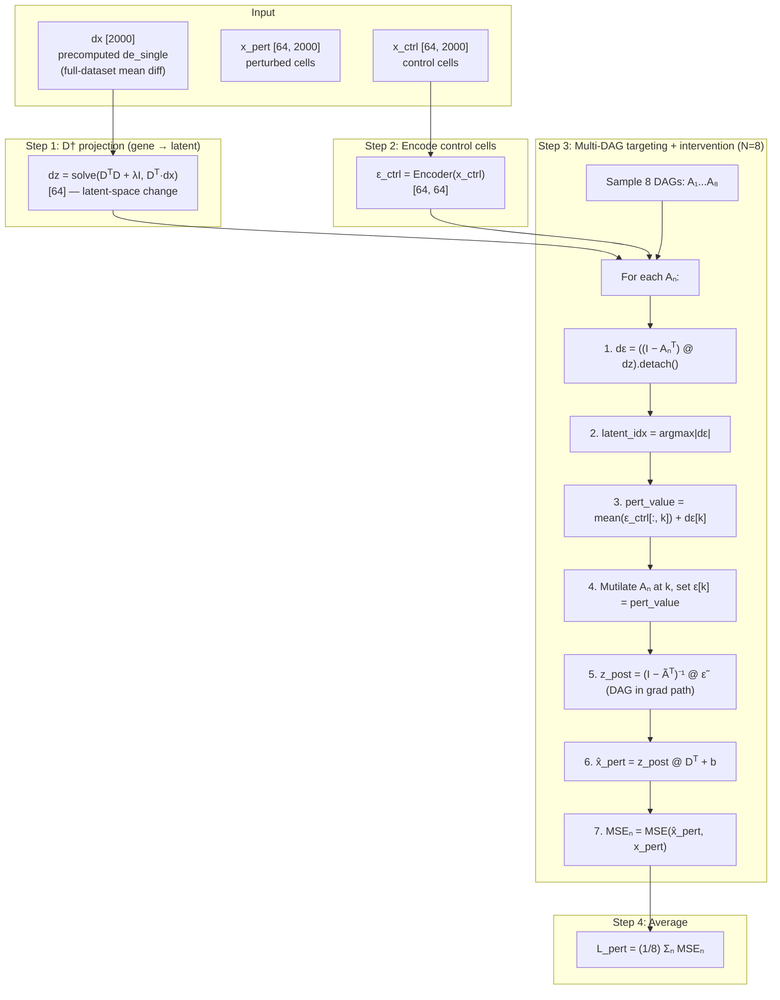

# Phase 1: Causal VAE Training — Detailed Walkthrough

> **Entry point:** `scripts/run_phase1.py` &rarr; `training/train_vae.py:train_vae()`
> **Default config:** `configs/default.yaml`

---

## 1. Architecture Overview

The CausalVAE has three learnable modules — an **encoder**, a **DAG module**, and a **decoder** — wired together through a linear Structural Causal Model (SCM).



### Tensor shapes at a glance

| Symbol | Shape | Description |
|--------|-------|-------------|
| `x` | `[B, 2000]` | Input gene expression (2000 HVGs) |
| `mu`, `log_var` | `[B, 64]` | Encoder outputs |
| `epsilon` (ε) | `[B, 64]` | Exogenous noise (reparameterized) |
| `theta` (θ) | `[64, 64]` | Edge logits (learnable parameter) |
| `A` | `[64, 64]` | Sampled soft adjacency matrix |
| `z` | `[B, 64]` | Latent endogenous variables |
| `D` | `[2000, 64]` | Decoder weight matrix |
| `x_hat` | `[B, 2000]` | Reconstructed expression |

### Key design choices

- **Linear SCM**: `z = (I - A^T)^{-1} @ epsilon` is solved via `torch.linalg.solve` (never an explicit inverse), with a safety clamp `z ∈ [-20, 20]`.
- **Linear decoder**: `x_hat = z @ D^T + b` — the linearity is deliberate because it enables projecting the latent DAG to gene space: `G_feat = D @ A @ D^T`, where `G_feat[i,j] > 0` suggests gene *i* regulates gene *j*.
- **Gumbel-Sigmoid** (not Gumbel-Softmax): each edge is an independent Bernoulli, sampled differentiably with temperature τ. Diagonal is masked to zero (no self-loops).
- **θ initialization**: all logits start at −5.0, so `sigmoid(−5/1.0) ≈ 0.007` — the graph starts nearly empty, keeping `(I − A^T)` well-conditioned.

---

## 2. Training Phases

Training runs for **150 epochs** divided into three phases with progressively more loss terms activated.

```
Epoch:  1          20  21         30  31         50  51              100 101        150
        │──────────│───│──────────│───│──────────│───│───────────────│───│──────────│
        │  PHASE A │       PHASE B               │         PHASE C                 │
        │          │                              │                                │
        │ Recon+KL │  DAG ramp    Full loss       │  τ annealing     LR drop       │
        │ +ortho   │  0→1 over    β annealing     │  1.0 → 0.25     ×0.1          │
        │ SCM OFF  │  10 epochs   0.01 → 1.0      │  (epochs 51-100)              │
        │ DAG froz │  SCM ON      SCM ON          │  SCM ON                       │
```

### Phase A — Reconstruction warm-up (epochs 1–20)

| What | Detail |
|------|--------|
| **Goal** | Train the encoder and decoder to reconstruct gene expression before introducing causal structure |
| **SCM** | **Bypassed** — `z = epsilon` (identity, no DAG influence) |
| **Active losses** | Reconstruction (MSE) + KL (β = 0.01) + Orthogonality |
| **DAG** | Frozen (gradients still flow to θ, but θ has near-zero edge probs and no DAG-specific losses push it) |
| **Checkpoint** | Best recon-only model saved to `checkpoints/phase1_best_recon.pt` |

**Why bypass the SCM?** At initialization, even though θ = −5 makes A nearly zero, solving `(I − A^T)^{-1}` with random noise in A (from Gumbel sampling) can be ill-conditioned. Phase A lets the encoder learn a good ε representation first.

### Phase B — DAG activation (epochs 21–50)

| What | Detail |
|------|--------|
| **Goal** | Learn causal structure while continuing to improve reconstruction |
| **SCM** | **Active** — `z = (I − A^T)^{-1} @ epsilon` |
| **DAG ramp** | All DAG-dependent loss weights multiply by a ramp factor: 0 → 1 linearly over 10 epochs (21–30) |
| **Active losses** | All 8 losses (see Section 4) |
| **β annealing** | KL weight: 0.01 → 1.0 linearly over 50 epochs starting at epoch 21 |
| **Checkpoint** | Best total loss saved to `checkpoints/phase1_best.pt` (this is what Phase 2 loads) |

**Why ramp DAG losses?** A sudden activation of DAGMA + sparsity + spectral penalties can shock the optimizer. The 10-epoch ramp smooths the transition.

### Phase C — Refinement (epochs 51–150)

| What | Detail |
|------|--------|
| **Goal** | Sharpen the DAG towards a binary graph; fine-tune all parameters |
| **τ annealing** | Temperature: 1.0 → 0.25 linearly over epochs 51–100 (makes Gumbel-Sigmoid sharper → more binary edges) |
| **LR drop** | At epoch 101, learning rate drops to `lr × 0.1` (1e-3 → 1e-4) |
| **All losses** | Fully active at full weight |

---

## 3. Data Flow

### 3a. Observational data (main training loop)

```
┌──────────────────────────────────────────────────────────┐
│ Raw data (Norman / Replogle)                             │
│  └─ load_norman() / load_replogle()                      │
│     └─ adata, gene_names, control_idx, single_perts      │
│        └─ Subset: control cells + single-pert cells      │
│           └─ X_train [N_train, 2000] float32             │
│              └─ TensorDataset → DataLoader               │
│                 batch_size=256, shuffle=True              │
└──────────────────────────────────────────────────────────┘
```

Training cells = control cells + single-perturbation cells. **Combinatorial perturbations are held out entirely** (never seen during training — reserved for evaluation).

### 3b. Interventional data (perturbation consistency)

```
┌───────────────────────────────────────────────────────────┐
│ make_interventional_dataset(data_dict)                    │
│  For each single-perturbation gene:                       │
│    triple = (X_ctrl[all], gene_expr_idx, X_pert[cells])   │
│                                                           │
│ Each training step (when DAG active):                     │
│  1. Pick 1 random gene from triples                       │
│  2. Sample 64 control cells + 64 perturbed cells          │
│  3. → (x_ctrl [64, 2000], gene_idx, x_pert [64, 2000])   │
└───────────────────────────────────────────────────────────┘
```

The interventional batch is **separate from the main DataLoader** — it's sampled independently each step and used only for the perturbation consistency loss.

---

## 4. Loss Function Deep Dive

The total loss combines **8 terms** with phase-dependent weighting:

```
L_total = L_recon + β·L_KL + λ_ortho·L_ortho
          + [DAG-active only:]
            L_DAGMA_aug + λ_sparse·L_sparse + λ_spectral·L_spectral
            + λ_pert·L_pert + λ_prior·L_prior
```

### Loss terms table

| # | Loss | Equation | λ (default) | Active | File:Line |
|---|------|----------|-------------|--------|-----------|
| 1 | **Reconstruction** | `MSE(x, x̂)` | 1.0 (implicit) | Always | losses.py:5-7 |
| 2 | **KL Divergence** | `−½ · mean(1 + log σ² − μ² − σ²)` | β: 0.01→1.0 | Always | losses.py:10-12 |
| 3 | **Orthogonality** | `‖D^T D / (‖D‖²_F/d) − I‖²_F` | 1.0 | Always | decoder.py:34-46 |
| 4 | **DAGMA Aug. Lagrangian** | `λ_dagma·h(A) + (ρ/2)·h(A)²` | λ: 0→∞, ρ: 1→100 | Phase B+ | losses.py:15-17 |
| 5 | **Sparsity** | `mean(\|A\|)` (L1) | 1.0 | Phase B+ | losses.py:20-22 |
| 6 | **Spectral Stability** | `ReLU(σ_max(A) − 0.95)` | 1.0 | Phase B+ | dag.py:180-195 |
| 7 | **Perturbation Consistency** | Multi-DAG MSE (see Sec. 5) | 10.0 | Phase B+ | losses.py:35-72 |
| 8 | **Biological Prior** | `−mean(log σ(G_feat[tf,tgt]))` | 0.1 | Phase B+ | losses.py:75-111 |

### 4.1 Reconstruction Loss

```
L_recon = (1/B) Σᵢ (1/G) Σⱼ (xᵢⱼ − x̂ᵢⱼ)²
```

Standard MSE between input and reconstructed gene expression. This is the primary signal throughout all phases.

### 4.2 KL Divergence

```
L_KL = −½ · (1/B) Σᵢ Σⱼ (1 + log σ²ᵢⱼ − μ²ᵢⱼ − σ²ᵢⱼ)
```

Regularizes the encoder's latent distribution toward N(0, I). Weighted by β which anneals from 0.01 → 1.0 to prevent posterior collapse (the "warm-up" trick from Bowman et al.).

### 4.3 Orthogonality Loss

```
L_ortho = ‖ D^T D / (‖D‖²_F / d + ε) − I ‖²_F
```

Encourages each of the 64 latent "programs" to decode to a **distinct** set of genes. Without this, multiple latent dimensions could collapse onto the same gene set, making the DAG structure unidentifiable.

### 4.4 DAGMA Augmented Lagrangian

The acyclicity constraint uses DAGMA (Bello et al., 2022):

```
h(A) = tr( (I + (s/d)·A⊙A )^d ) − d
```

where `s = 1.0`, `d = 64`, and `A⊙A` is element-wise squaring. **h(A) = 0 if and only if A is a DAG.**

This is enforced via an augmented Lagrangian:

```
L_DAGMA = λ_dagma · h(A) + (ρ/2) · h(A)²
```

The multipliers λ_dagma and ρ are updated every 20 epochs (see Section 6).

### 4.5 Sparsity Loss

```
L_sparse = (1/d²) Σᵢⱼ |Aᵢⱼ|
```

Encourages a sparse graph. Without this, the Gumbel-Sigmoid can converge to a dense graph that happens to be acyclic but is uninterpretable.

### 4.6 Spectral Stability Loss

```
L_spectral = ReLU(σ_max(A) − 0.95)
```

where `σ_max(A)` is the largest singular value of A. This keeps the spectral radius of A below ~0.95, ensuring `(I − A^T)` is well-conditioned and the SCM solve doesn't explode.

### 4.7 Perturbation Consistency Loss

See Section 5 for the full flow.

### 4.8 Biological Prior Loss

Uses a **Margin Ranking Loss** on the gene-space GRN `G_feat = D @ A @ D^T`:

```
L_prior = MarginRankingLoss(G_feat[known_TF→target], G_feat[random_background], margin=0.1)
```

Known TF→target interactions from CollecTRI are pushed to have higher scores than randomly sampled background edges. This is more robust than the original log-sigmoid formulation because it explicitly contrasts signal vs. noise rather than pushing all known edges toward a fixed threshold.

---

## 5. Perturbation Consistency Loss — Detailed Flow (v2, D†-guided)

This is the critical loss that teaches the DAG to model **interventional** (not just observational) distributions. It uses real perturbation data to supervise the SCM's do-calculus predictions.

The v2 loss uses the **decoder pseudoinverse** D† to robustly project gene-space perturbation effects to latent space, replacing the fragile `argmax|D[gene,:]|` mapping.



### Why is this important?

Without this loss, the model could learn a DAG that perfectly explains observational correlations but gives wrong predictions under perturbation. Consider: if gene A and gene B are correlated because they share an upstream regulator C, a model might incorrectly learn A→B. The perturbation consistency loss forces the model to predict `do(A=v)` correctly — and if A doesn't actually cause B, the prediction `x̂_pert` won't match `x_pert`, penalizing the wrong edge.

### Why D† instead of argmax|D|?

The old approach (`argmax|D[gene,:]|`) used a single row of D to determine which latent to intervene on. This is fragile because:
1. During early training, D hasn't converged, so the mapping is nearly random
2. It ignores the full structure of D — a gene may load onto multiple latent programs
3. The intervention value was derived from `ε_pert[:, latent_idx]`, compounding any mapping error

The D†-based approach:
1. **Uses the full decoder matrix** to project dx (gene-space change) to dz (latent-space change): `dz = D†·dx`
2. **Filters through the DAG** to find the exogenous target: `dε = (I-A^T)·dz` — different DAG samples may identify different targets
3. **Data-driven intervention value**: `mean(ε_ctrl[:, k]) + dε[k]` shifts the control epsilon by the amount implied by the observed perturbation

### Why mutilation is essential

A naive approach might add dε directly to ε_ctrl and forward through the SCM. But mathematically:
```
z_post = (I-A^T)^{-1} · (ε_ctrl + (I-A^T)·dz) = z_ctrl + dz
```
The DAG cancels out! The mutilation step (zeroing incoming edges to the target node) breaks this cancellation, keeping A in the gradient path.

### Key details

- **D† via solve**: `dz = solve(D^T D + 1e-6·I, D^T·dx)` — cheaper and more stable than `torch.linalg.pinv`
- **dx from de_single**: Uses the precomputed full-dataset mean difference (not noisy batch estimates)
- **Target detached**: `dε.detach()` for argmax prevents adversarial gradients through the targeting step
- **Multi-DAG averaging**: 8 DAG samples for robustness; different samples may target different latents
- **Clamping**: `torch.clamp(pert_loss, max=50.0)` prevents gradient explosions

---

## 6. DAGMA Augmented Lagrangian Updates

The DAGMA constraint `h(A) = 0` is enforced via the standard augmented Lagrangian method, updated **every 20 epochs**:

```
                              ┌──────────────────────────────┐
                              │  Every 20 epochs:            │
                              │                              │
                              │  Compute h(A) with eval-mode │
                              │  edge probabilities           │
                              │                              │
                              │  if h(A) > 1e-4:            │
                              │    λ ← λ + ρ · h(A)         │
                              │    ρ ← min(2ρ, 100)         │
                              │                              │
                              │  (if h(A) ≤ 1e-4: no update │
                              │   — constraint is satisfied) │
                              └──────────────────────────────┘
```

| Parameter | Init | Update rule | Max |
|-----------|------|-------------|-----|
| `λ_dagma` | 0.0 | `λ += ρ · h(A)` | unbounded |
| `ρ_dagma` | 1.0 | `ρ *= 2` | 100 |

**Intuition**: λ is a penalty weight on the constraint violation; ρ is a quadratic penalty coefficient. If the graph is still cyclic (h(A) > 1e-4), we increase both to apply stronger pressure. If it's already a DAG, we leave them alone.

---

## 7. Annealing Schedules

All schedules over the 150-epoch training run:

```
Value
  │
1.0 ┤                    ╱━━━━━━━━━━━━━━━━━━━━━━━━━━━━━━━━  β (KL weight)
    │                 ╱
    │              ╱
    │           ╱         ━━━━━━━━━━━━━━━━━━━━━━━╲           τ (temperature)
    │        ╱                                     ╲
    │     ╱                                         ╲
0.25┤  ╱                                              ╲━━━━  τ_min
    │
0.01┤━━━━━━━━━━━╱                                            β_start
    │
  0 ┤━━━━━━━━━━╱‾‾‾‾‾‾‾‾‾━━━━━━━━━━━━━━━━━━━━━━━━━━━━━━━━  dag_ramp
    └──┬──────┬┬─────────┬┬──────────────────────┬┬────────┬──
       1     20 21       30 31                   100 101   150
              Phase A      Phase B                  Phase C
```

| Schedule | Start | End | Epoch range | Formula |
|----------|-------|-----|-------------|---------|
| **β** (KL weight) | 0.01 | 1.0 | 21 → 71 | Linear: `0.01 + 0.99 * (epoch-21)/50` |
| **τ** (Gumbel temp) | 1.0 | 0.25 | 51 → 100 | Linear: `max(0.25, 1.0 - (epoch-50)/50 * 0.75)` |
| **dag_ramp** | 0.0 | 1.0 | 21 → 30 | Linear: `(epoch-20)/10` |
| **LR** | 1e-3 | 1e-4 | step at 101 | `lr *= 0.1` |
| **LR warmup** | ~0 | 1e-3 | 1 → 5 | `LinearLR(start_factor=1e-3)` |

Additionally, `ReduceLROnPlateau(patience=10, factor=0.5)` is active after warmup ends, monitoring total loss.

---

## 8. Checkpointing Strategy

```
                Phase A                    Phase B + C
           ┌────────────────┐     ┌──────────────────────────┐
           │                │     │                          │
           │ Track best     │     │ Track best total loss    │
           │ recon-only     │     │ across ALL active losses │
           │ loss           │     │                          │
           │                │     │                          │
           │ Save to:       │     │ Save to:                 │
           │ phase1_best_   │     │ phase1_best.pt ← USED   │
           │ recon.pt       │     │ BY PHASE 2               │
           └────────────────┘     └──────────────────────────┘

           Every 10 epochs: phase1_epoch{N}.pt (periodic snapshots)
```

### What's saved in each checkpoint

```python
{
    'epoch': int,
    'model_state_dict': ...,      # full model weights
    'optimizer_state_dict': ...,   # optimizer state (for resuming)
    'loss': float,                 # total loss at that epoch
    'config': dict,                # full config for reproducibility
    'gene_names': list,            # gene name list
    'edge_probs': np.array,        # A probability matrix [64, 64]
}
```

---

## 9. Gradient Management

### Gradient accumulation

Effective batch size = `batch_size × accumulation_steps` = 256 × 4 = **1024**.

```python
scaled_loss = losses['total'] / accumulation_steps  # scale by 1/4
scaled_loss.backward()                               # accumulate grads

if (batch_idx + 1) % accumulation_steps == 0:       # every 4 mini-batches
    clip_grad_norm_(model.parameters(), 1.0)         # clip
    optimizer.step()                                  # update
    optimizer.zero_grad()                             # reset
```

### Learning rate schedule

```
LR
 │
1e-3 ┤          ╱━━━━━━━━━━━━━━━━━━━━━━━━━━━━━━━━━━━━━━━╲
     │        ╱                                  (plateau │╲
     │      ╱                                    may cut  │ ╲
     │    ╱                                      earlier) │  ╲
1e-4 ┤  ╱                                                 ╲━━━━━━
     │╱  warmup                                   step drop
1e-6 ┤━╱
     └─┬────┬────────────────────────────────────┬────────┬────
       1    5                                   100      150
```

1. **Warmup** (epochs 1–5): Linear from `lr×1e-3` to `lr` via `LinearLR`
2. **Plateau** (epochs 6–100): `ReduceLROnPlateau(patience=10, factor=0.5)` — halves LR if total loss stalls for 10 epochs
3. **Step drop** (epoch 101): Hard drop to `lr × 0.1`

### Gradient clipping

`torch.nn.utils.clip_grad_norm_(model.parameters(), max_norm=1.0)` — global L2 norm clipping applied after every accumulation step.

---

## 10. Putting It All Together — One Epoch

Here is the complete flow for a single epoch during Phase B/C:

```
┌─────────────────────────────────────────────────────────────────┐
│ EPOCH START                                                     │
│                                                                 │
│  1. Compute phase parameters:                                   │
│     dag_active? β? τ? dag_ramp?                                 │
│     model.set_tau(τ)                                            │
│                                                                 │
│  2. For each mini-batch in DataLoader:                          │
│     ┌──────────────────────────────────────────────────────┐    │
│     │ a. Forward pass:                                     │    │
│     │    x → Encoder → ε → SCM(ε, A) → z → Decoder → x̂   │    │
│     │                                                      │    │
│     │ b. Sample interventional batch:                      │    │
│     │    Pick random gene, sample 64 ctrl + 64 pert cells  │    │
│     │    Compute perturbation_consistency_loss              │    │
│     │                                                      │    │
│     │ c. Compute biological_prior_loss (if CollecTRI avail)│    │
│     │                                                      │    │
│     │ d. compute_total_loss(all 8 terms)                   │    │
│     │                                                      │    │
│     │ e. Gradient accumulation:                            │    │
│     │    (loss / 4).backward()                             │    │
│     │    Every 4th batch: clip_grad → step → zero_grad     │    │
│     └──────────────────────────────────────────────────────┘    │
│                                                                 │
│  3. Average epoch losses                                        │
│                                                                 │
│  4. LR scheduler step (warmup or plateau)                       │
│                                                                 │
│  5. DAGMA Lagrangian update (every 20th epoch)                  │
│                                                                 │
│  6. Checkpoint if best loss                                     │
│                                                                 │
│  7. Log to CSV + wandb                                          │
│                                                                 │
│ EPOCH END                                                       │
└─────────────────────────────────────────────────────────────────┘
```

---

## Appendix: Default Hyperparameters

From `configs/default.yaml`:

| Parameter | Value | Description |
|-----------|-------|-------------|
| `n_hvg` | 2000 | Number of highly variable genes |
| `latent_dim` | 64 | Latent space dimensionality |
| `tau_init` | 1.0 | Initial Gumbel temperature |
| `tau_min` | 0.25 | Final Gumbel temperature |
| `n_dag_samples` | 16 | DAG bootstrap samples (inference) |
| `n_epochs` | 150 | Total training epochs |
| `batch_size` | 256 | Mini-batch size |
| `accumulation_steps` | 4 | Gradient accumulation steps |
| `lr` | 1e-3 | Initial learning rate |
| `beta_start` / `beta_end` | 0.01 / 1.0 | KL weight annealing range |
| `beta_anneal_epochs` | 50 | KL annealing duration |
| `lambda_pert` | 10.0 | Perturbation consistency weight |
| `lambda_sparse` | 1.0 | Sparsity penalty weight |
| `lambda_spectral` | 1.0 | Spectral stability weight |
| `lambda_ortho` | 1.0 | Orthogonality weight |
| `lambda_prior` | 0.1 | Biological prior weight |
| `dagma_rho_init` | 1.0 | DAGMA quadratic penalty init |
| `dagma_rho_max` | 100 | DAGMA quadratic penalty cap |
| `dagma_lambda_init` | 0.0 | DAGMA Lagrange multiplier init |
| `reconstruction_phase_epochs` | 20 | Phase A duration |
| `lr_warmup_epochs` | 5 | LR warmup duration |
| `dag_warmin_epochs` | 10 | DAG loss ramp-in duration |
| `pert_n_dag_samples` | 8 | DAG samples for pert loss |
