# Briggs 2026 as an external benchmark for the exp20 causal world model + RL planners

**A complete, step-by-step methodology & results report.**
Author: Shervin Goudarzi (scCausalRL). Generated 2026-07-18. Branch `experiments/shift-encoder-variants`.

---

## 0. One-paragraph summary

We used **Briggs et al. 2026** (Cell Systems, GSE328457) — a pooled combinatorial TF-overexpression
screen that reprograms hESCs into HSPC-like cells and measures each TF combination's 14–28-day
HSPC-similarity endpoint — as an **external answer key** for (i) our exp20 combinatorial causal-VAE
**world model (WM)** and (ii) the **RL planners** built on it. Briggs shares the **same ORF library and
platform** as the Joung atlas the WM was trained on, so this is a *longer-timepoint, higher-order, selected*
test of the same assay — not a cross-domain transfer. Three findings:

1. **The one-step do-operator does not predict Briggs's high-order endpoints** (Spearman ~0.32 for
   singles, decaying to ~0 by k >= 7). Note this is **not a domain transfer** — Briggs uses the *same ORF
   library/platform as Joung*. The gap is **timescale + selection + combinatorial order**: our WM predicts
   the Joung **7-day** differentiation snapshot, Briggs measures a **14–28-day** endpoint after CD34/CFU
   selection, at TF-set sizes (k ~5) well beyond the <=2-TF training ceiling.
2. **The frozen WM latent nonetheless linearly encodes fate at every k.** A simple **Ridge readout** on
   the 357-dim latent recovers Spearman **+0.56 to +0.71, holding at k = 7** (Fig 1) — the causal WM stays
   frozen; only a linear head is learned (the safe form of "co-training"). With a **clean hESC / pure-Joung-
   control background** (section 15.1, Fig 7) this rises to **+0.80** and lifts RL recovery too. Crucially
   (section 15.6), the **production model — best on Joung DE — also hits +0.80 on Briggs fate via the readout**:
   one WM is good at *both* tasks; the Joung↔Briggs "tension" was an artifact of the raw (non-learned) axis.
3. **Support-constrained planning/distillation over that readout recovers real HSPC biology.** Naive
   reward maximization *exploits* the readout off-distribution; the **MOReL/MOPO Mahalanobis support
   penalty** fixes it (Fig 4), and the value-add ladder reproduces our prior Joung result **MPC ~ distill
   >> from-scratch PPO** (Fig 5), recovering canonical HSPC drivers (Fig 6). **Leakage caveat (section
   15.2):** a leave-hit-out audit shows the *generic-driver* recovery survives leak-free (10× base) but the
   *specific* P1/P2-member recovery is substantially in-sample. **set-PPO can be fixed** by warm-start +
   fine-tune (section 15.4, beats distill 2×). A **de-novo candidate table** is produced for wet-lab follow-up.

All figures are regenerable with `scripts/make_briggs_figures.py`; all numbers below are cited to the
producing script/log.

---

## Table of contents
1. [Motivation & the governing constraint](#1-motivation--the-governing-constraint)
2. [The Briggs dataset](#2-the-briggs-dataset)
3. [The exp20 world model (recap)](#3-the-exp20-world-model-recap)
4. [The HSPC fate metric (direction, not position)](#4-the-hspc-fate-metric-direction-not-position)
5. [The observed answer key (containment augmentation)](#5-the-observed-answer-key-containment-augmentation)
6. [Phase 1 — WM fidelity gate](#6-phase-1--wm-fidelity-gate)
7. [Model sweep & base-model selection](#7-model-sweep--base-model-selection)
8. [Track 2 — the readout head](#8-track-2--the-readout-head)
9. [The merged RL reward](#9-the-merged-rl-reward)
10. [Phase 2 — RL planner ladder](#10-phase-2--rl-planner-ladder)
11. [De-novo candidate generation](#11-de-novo-candidate-generation)
12. [Best-of-both world model](#12-best-of-both-world-model)
13. [Conclusions, caveats & limitations](#13-conclusions-caveats--limitations)
14. [Reproducibility index](#14-reproducibility-index)
15. [Follow-up analyses: clean backgrounds, leakage audit, Joung-RL ladder, set-PPO resolution](#15-follow-up-analyses-clean-backgrounds-leakage-audit-joung-rl-ladder-set-ppo-resolution)

---

## 1. Motivation & the governing constraint

The exp20 WM is a shift-encoder causal-VAE do-operator trained on the **Joung TF atlas** (hESC -> many
fates by single-TF OE, plus 40 two-TF combos). We want to know whether it *composes* TF sets into the
correct **fate**, and whether RL planners over it can *design* HSPC cocktails that recover/beat known
ones. Briggs is the ideal external test because it screens thousands of TF combinations for exactly one
fate (HSPC) with arrayed-validated winners.

**The constraint that governs every design choice:** Briggs's labels are **14–28-day fate endpoints after
CD34/CFU selection**, whereas our do-operator predicts the Joung **7-day differentiation snapshot** ("one
step" = one do-op step to the 7-day post-OE state, *not* an instantaneous response — cells have already
begun committing, which is why single-TF drivers do transfer). So the evaluation target must be
**fate / HSPC-similarity** (Briggs's own metric), *not*
one-step delta-expression, and it must run on **directly-observed + arrayed-validated combos only** — never
the 1.8 M "augmented interior" of the landscape, whose construction assumes the very additivity we are
testing. The one-step -> endpoint gap is treated as a first-class, explicitly-measured caveat, not assumed
away.

---

## 2. The Briggs dataset

Raw GEO data at `/large_storage/goodarzilab/shervin/CausalBioRL/Briggs_TF_2026/`; the merged all-cells
object is decompressed once and cached at `.../Briggs_TF_2026/_decompressed/all_cells_final_v2.h5ad`.

| Property | Value |
|---|---|
| Cells x genes | 156,076 x 31,915 (screen + reference samples) |
| MOI | high — ~5 TFs per cell |
| Per-cell TF barcodes | `obsm['TF_UMIs_filt']` (x800 isoforms) -> collapsed to `uns['TF_names']` (388 unique genes) |
| Directly-observed combos | 25,176 real TF-sets (before any augmentation) |
| Arrayed winners | **P1** = {TAL1, RPA3, ZFP90, RNF138, LMO2, KLF2}; **P2** = {DDIT3, MZF1, HOXB3, MIER1, SIRT6, ZNF85} |
| Gold-standard cocktails | Sugimura-7 {ERG, HOXA5, HOXA9, HOXA10, LCOR, RUNX1, SPI1}; Lange-4 {ETV2, GATA2, LMO2, TAL1} |
| Reference cells (fate axis) | `sample == 'pHSC'` (primary HSPCs, 4,776 cells), `pHep`, `pHSC_cfu` |

**Vocabulary coverage.** Of the 388 Briggs TF genes, only ~104 are on our WM's 4,366-gene axis, and of
those ~90 are in the *trained* vocabulary (`effective_tf_genes.txt`, 495 TFs). We therefore report a
**tiered pool**: a *reliable core* (in-training) plus a *zero-shot extension* (any on-axis TF via the ESM
shift-encoder), always flagging which tier a result uses. Several master regulators (GATA2, TAL1, ERG,
SPI1, CEBPA) are only reachable through the zero-shot tier.

**Supplementary.** `mmc5.xlsx` sheet `Arrayed_screens` supplied all RL recovery targets (P1/P2, arrayed
panels A/B/C, gold standards) and the 388-TF library. Briggs's *derived* per-combo tables were not in the
GEO folder, so we **reconstruct** the per-combo HSPC-similarity ourselves (section 5) and cross-check
against the paper-text functional numbers (P1 = 10.9%, P2 = 8.4% CD34+; Sugimura 10.2%, Lange 35.5%).

---

## 3. The exp20 world model (recap)

`experiments/exp20_load_bearing`, config family `v2b_*`. Architecture:

- **Encoder** MLP -> per-cell exogenous noise eps (latent dim **357**, set by a SENA/`masked_go` gene-set mask).
- **Latent SCM** z = (I - A^T)^-1 eps with a learned Gumbel-gated DAG A (prior-off canonical, `lambda_prior=0`).
- **Linear-ish `masked_go` decoder** z -> 4,366 genes.
- **Shift-encoder do-operator** (ESM descriptors): each TF g maps to a latent shift `compute_shift(g)`;
  a rank-32 **Option-C interaction head** adds pairwise non-additivity
  `compute_interaction(set) = W_out( 0.5*[(sum x_i)^2 - sum x_i^2] )`, `x_g = U(esm_g)` — zero on singles,
  symmetric, ESM-keyed (zero-shot), pairwise-only.
- **Structural intervene mode + target gate**: a set is applied by injecting the summed shift into the
  exogenous noise and doing one mutilated solve, so A is load-bearing by construction.

The do_mean composition (validated combo eval) for a set G:

```
S      = sum_{g in G} compute_shift(g) + compute_interaction(G)      # summed latent shift
u      = mean_{g in G} clip(beta*|compute_shift(g)|, max=1)          # per-single-mean intervention strength
eps~   = eps + S                                                     # structural: inject into exogenous noise
z_post = (I - diag(1-u) A^T)^-1 eps~                                 # one mutilated solve
```

---

## 4. The HSPC fate metric (direction, not position)

**Key methodological decision.** Our model predicts a *small delta on top of a large hESC baseline*.
Scoring the absolute predicted **position** (`cosine(control + delta, HSPC centroid)`) is dominated by
hESC-ness and cannot discriminate combos — this is what tanked a naive "raw cosine to the pHSC mean" to
AUROC 0.78. The correct quantity is the **direction of movement**: project the *displacement from control*
onto the **fate axis**.

```
d_HSPC = z_HSPC_mean - z_background            # the fate direction (gene space)
Delta(G) = state(G) - background               # displacement of a combo from the background
rho(G)   = <Delta(G), d_HSPC> / (||Delta(G)|| * ||d_HSPC||)   # cosine alignment (unnormalized projection reported too)
```

- **Space.** For the Briggs eval we work in **gene / decoder space**, not our latent — Briggs cells are
  OOD to the Joung-trained encoder, so a latent axis built from them would be unreliable, and Briggs's own
  metric is gene-space. (The *latent* fate axis is reserved for RL, sections 9-10, and is built from a
  Joung-context proxy, never by encoding Briggs cells.)
- **Two independent references, cross-checked.** (a) **Briggs-native**: `d = pHSC_mean - screen_bulk`;
  (b) **Cao 2020 fetal atlas**: the `Liver-Hematopoietic stem cells` deviation signature from
  `cao_type_mean_logexpr.csv` (peak-mean-centered over 165 fetal cell types, discriminative half). Both
  are in `evaluation/briggs/hspc_sim.py` (`fate_axes`, `project`, `build_cao_hsc_signature`).

**Validation.** On held-out reference cells the two centroids separate pHSC vs pHep at AUROC **1.00**
(Briggs-native) / **0.99** (Cao), and their per-cell scores correlate **r = 0.86** — the metric is real
before any modeling.

---

## 5. The observed answer key (containment augmentation)

*File:* `evaluation/briggs/reconstruct_targets.py` -> `results/briggs/observed_combo_targets.csv`.

High MOI means an *exact* TF-set has only 3-6 cells -> noisy. Briggs's own fix is **sub-combination
augmentation**: a combo C's effect is estimated over **all cells whose TF-set contains C** (containment),
which powers the estimate. We score each of the 25,176 directly-observed sets this way:

```
Delta_obs(C) = mean{ cells whose TF-set contains C } - screen_bulk
rho_obs(C)   = cosine( Delta_obs(C), d_HSPC )     # for both the Briggs-native and Cao axes
```

Result: **18,597 combos** with >= 3 containing cells (k = 1..13, peak at k = 5-6). The two axes agree at
**Spearman +0.81** at the combo level (up from 0.17 for the naive exact-match state-cosine — the direction
+ augmentation fix), and **P1 ranks at percentile 100** on the Briggs-native axis — the metric puts
Briggs's top validated cocktail at the very top. The epistasis/non-additivity analysis is kept strictly on
directly-observed pairs; augmentation is used only for this powered rank target.

---

## 6. Phase 1 — WM fidelity gate

*File:* `evaluation/briggs/predict_combo.py`. For each answer-key combo we run the do_mean do-operator
(with the interaction head), drift-center the predicted delta across combos (parity with `rho_obs`), and
project onto the **Cao axis in the model's gene space** (the one axis mappable to both spaces). Headline =
**Spearman(rho_pred, rho_obs)**, split by k, plus a head-ON-vs-OFF comparison.

**Result (production model `v2b_prod_deg8_all40`):** a **soft fail at cocktail scale.**

| Domain | Spearman(rho_pred, rho_obs) | interaction-head gain |
|---|---|---|
| all combos (k=1-13) | **+0.06** | +0.05 |
| singles (k=1) | **+0.32** | ~0 |
| k <= 2 | +0.15 | **+0.07** |
| k <= 3 | +0.06 | +0.04 |
| k = 7 | +0.01 | — |

The one-step prediction is decent for singles, modest for pairs (the interaction head *does* help where it
can, consistent with its internal LOTO/LOPO validation), and **indistinguishable from zero by k >= 7**.
This is the one-step -> multi-week-endpoint gap plus the <=2-TF training ceiling, quantified. It was the
pre-registered risk, and it decides the rest of the program: raw one-step prediction is not a usable oracle
for cocktail-scale design, so we (a) find a better readout (section 8) and (b) constrain RL to the data
manifold (sections 9-10).

---

## 7. Model sweep & base-model selection

*File:* `evaluation/briggs/sweep_fidelity.py` over 33 checkpoints (deg/mmd/head/arch axes + the full-combo
trainings), scored on the discriminating slice (reliable, k <= 3), then a seed-robustness confirmation.

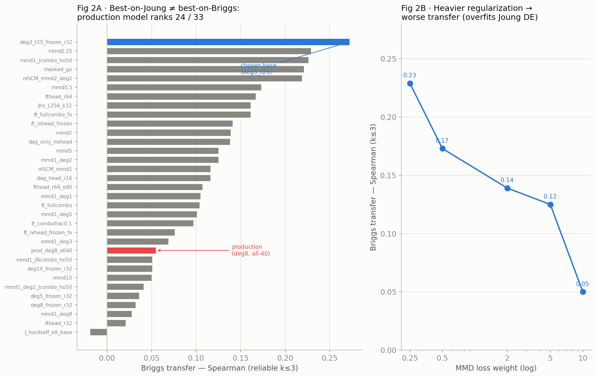

**The production model is 24th of 33.** The DEG-loss and MMD-loss weights that made it the best *Joung*
combo predictor **anti-correlate with Briggs transfer** (Fig 2B): heavy regularization sharpens
Joung-specific DE that overfits and does not carry to Briggs's coarse multi-week fate direction; lighter
models keep a smoother, transferable fate axis. The best transferrer is **`v2b_deg3_t25_frozen_r32`**
(low DEG weight, frozen rank-32 interaction head), and it is **seed-robust** (s1 k <= 3 = +0.272, s7 =
+0.221 — both ~4-5x the production +0.055), whereas several other high scorers are seed-fragile
(`mmd1_deg2`: s1 = 0.14 vs s7 = 0.29). **Base settled: `v2b_deg3_t25_frozen_r32_s1`** for all Briggs/RL
work.

---

## 8. Track 2 — the readout head

*File:* `evaluation/briggs/readout_head.py`. **Question:** the raw one-step projection loses fidelity at
high k — but does the WM's *latent counterfactual* `z_post` still carry the endpoint-fate signal,
recoverable by a small supervised head on a **held-out** Briggs combo split? If yes, we can score cocktails
for RL **without touching the frozen causal WM** — only a linear head is learned.

Feature = frozen-WM `z_post` (mean over control cells) from the do_mean do-operator. Target = observed
`rho_obs`. Two splits: random 80/20 and a strict **leave-TF-out** (hold out all combos containing any of 20
TFs -> 14.7 k novel-TF test combos).

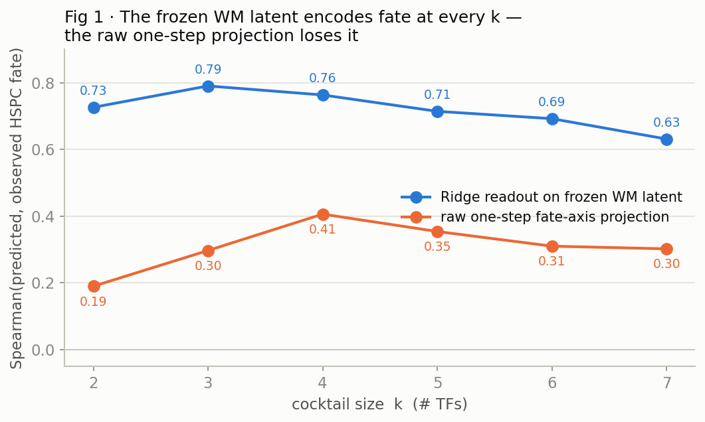

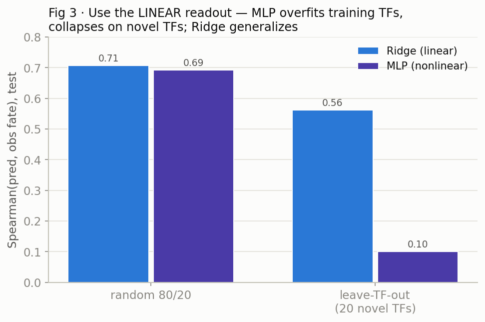

**Two clean conclusions:**
1. **A linear Ridge on the 357-dim latent recovers fate fidelity to +0.56 (leave-TF-out) / +0.71 (random),
   holding across all k including k = 7** (+0.50 to +0.63) — where the raw projection was ~0.2 (Fig 1). The
   high-k signal was in the latent all along; the hand-picked Cao axis just couldn't read it.
2. **Use the linear readout, not an MLP** (Fig 3). On the strict leave-TF-out test the MLP collapses to
   +0.10 (memorizes training TFs) while Ridge holds at +0.56 — the linear head generalizes to novel TFs by
   riding the WM's ESM zero-shot shift encoder, exactly what de-novo design needs.

Both readouts (`_rho_cao`, `_rho_briggs`) are refit on all data and saved to
`results/briggs/readout_ridge_<tag>_<target>.npz` for reuse as the RL reward.

---

## 9. The merged RL reward

*File:* `experiments_rl/core/briggs_fate_reward.py` (`FateReward`). One reward, used identically by every
planner, that fuses the two design tracks:

```
r~(G) = min_j  readout_j( z_post(G) )                  # Track 2: trustworthy high-k fate score
        - lambda * std_{A ~ DAG ensemble}( fate )      # epistemic (structural) uncertainty
        - gamma  * Mahalanobis( z_post(G) ; observed-combo manifold )   # Track 1: off-manifold penalty
```

- **Cross-readout min** (`readout_cao`, `readout_briggs`): a cocktail must score high on *both* fate axes.
- **DAG-ensemble std**: the epistemic-uncertainty term (std of the fate score across sampled hard-gate
  adjacency matrices) — the existing `pessimism_alpha` mechanism, now on the fate readout.
- **Mahalanobis support penalty** (`set_support`): `sqrt((z-mu)^T Sigma^-1 (z-mu) / d)` with mu, Sigma from
  the 15,981 observed-combo latents (cached `readout_feats_*.npz`). This is the MOReL/MOPO offline-RL fix —
  the readout is accurate *on* the Briggs combo distribution, so penalize proposals that stray *off* it.

**Do-operator correctness (C1).** The RL operator's batched path (`apply_many`) previously used the
`|sum S_g|` intervention-strength form and *dropped the interaction head* — silently scoring combos
additively. We added `apply_sets` (`experiments_rl/core/wm_operator.py`), which reproduces
`intervene_shift_mutilate` exactly (interaction head + per-single-mean u), verified to **max abs error
1e-6** on singles/pairs/k=5; the old `apply_many` diverged by 0.70 (k=2) and 3.11 (k=5), confirming the
bug and the fix. The per-step env path (`_intervene_gated`) was aligned the same way.

**RL-free reward sanity** (`experiments_rl/analysis/briggs_reward_sanity.py`): the reward ranks Briggs's
validated cocktails high (P2 percentile 96, Lange-4 90). Textbook-driver enrichment is only weak
(p ~ 0.1) — which is *expected*: Briggs's finding is that unbiased screening beats textbook cocktails, so a
reward faithful to Briggs's landscape ranks non-canonical hits (e.g. P2's DDIT3) high, not the textbook
set.

---

## 10. Phase 2 — RL planner ladder

### 10.1 Reward exploitation and the support fix

*File:* `experiments_rl/analysis/briggs_fate_mpc.py` — beam-search MPC over the tiered pool maximizing r~
up to k = 7.

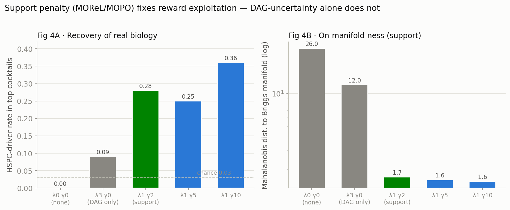

**Naive maximization exploits the readout** (Fig 4): with no penalty the top cocktails score fate +1.3 but
sit at Mahalanobis **26** (deep off-manifold) and recover **zero** real biology — off-distribution reward
hacking. **DAG-ensemble pessimism alone is insufficient** (lambda 3: maha still 10-14, driver rate 0.09) —
a real methodological point that *structural* uncertainty is not *data support*. **The Mahalanobis support
penalty is the fix**: at lambda = 1, gamma = 2 the proposals snap onto Briggs's manifold (maha 1.7), keep
positive fate, and recover real HSPC biology (driver rate 0.28 = 9x base). **Operating point: lambda = 1,
gamma = 2.**

### 10.2 The value-add ladder (M0 / M2 / M3)

Same reward, three planners:
- **M0 fate-MPC** — beam-search planner (`briggs_fate_mpc.py`).
- **M2 set-PPO** — from-scratch learned policy (`briggs_fate_set_ppo.py`), env fate-mode in `core/env.py`.
- **M3 distill** — behavior-clone the planner's cocktails into the SetPolicy (`briggs_fate_distill.py`).

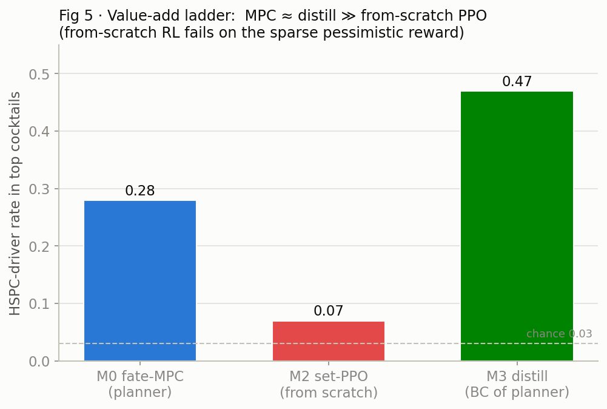

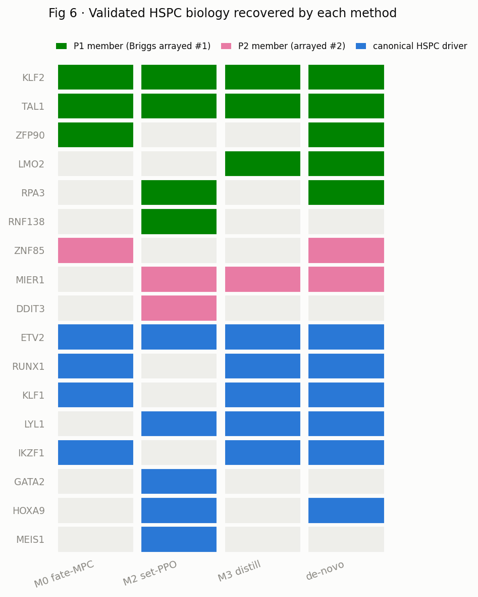

| Method | HSPC-driver rate | verdict |
|---|---|---|
| M0 fate-MPC (planner) | **0.28** | works |
| M2 set-PPO (from scratch) | **0.07** | **fails** — pessimistic reward too sparse (random cocktails off-manifold -> clipped -> no gradient; reward pinned at the -10 clip, entropy never drops) |
| M3 distill (BC of planner) | **0.47** | **best** — imitation sidesteps the sparse-reward exploration wall, then concentrates on the highest-quality region |

This **reproduces our prior Joung finding "MPC ~ distill >> from-scratch PPO"** on an external benchmark.
(M1 seq-PPO is omitted — it shares M2's from-scratch-exploration failure mode.) Across methods the
recovered biology (Fig 6) includes **P1 members KLF2/TAL1/ZFP90/LMO2/RPA3, P2 members ZNF85/MIER1/DDIT3,
and drivers ETV2/RUNX1/KLF1/LYL1/IKZF1/GATA2/HOXA9** — the validated hits and canonical regulators, at
9-16x the chance rate.

---

## 11. De-novo candidate generation

*File:* `briggs_fate_mpc.py --topN 40 --div_jaccard 0.6` (calibrated lambda1 gamma2) ->
`results/briggs/denovo_candidates.csv`.

40 diverse, **on-manifold** (mean Mahalanobis 1.63), mostly **novel** (29/40 not in Briggs's observed set)
cocktails, driver rate 0.26. Each row carries fate score, support distance, novelty flag, and P1/P2/driver
overlap — a wet-lab-ready candidate table. Representative novel cocktails that blend canonical drivers with
Briggs's non-canonical hits:

- `[ETV2, FOXP1, IKZF1, MAX, RUNX1, ZNF268]` — 3 drivers
- `[ETV2, IKZF1, RUNX1, ZNF85]` — 3 drivers + P2 member (k = 4)
- `[KLF2, RUNX1, TAL1]` — 2 P1 members + 2 drivers
- `[HOXA9, LYL1]` — classic hemato pair

---

## 12. Best-of-both world model

*Config:* `configs/ablations/lb25bestboth/v2b_deg3_t25_frozen_r32_all40.yaml` = the deg3_t25 backbone
(good transfer) + interaction head trained on **all 40** combos (`combo_holdout_keys: []`). Trained to
`results/grid/v2b_deg3_t25_frozen_r32_all40/`.

Its Ridge readout fidelity is **identical to the 11-combo base (+0.70 overall, +0.64 at k >= 7)**.

**IMPORTANT UPDATE (section 15.6):** the model *sweep* (section 7) measured the **raw** fate-axis projection,
which anti-correlates with DEG weight and put the production model 24th/33. But a **learned readout on the
production (deg8) latent hits +0.80 — identical to the fate-optimized model.** So Briggs-transfer is *not*
a backbone property of the *latent*; it was an artifact of the raw metric. **The production model
`prod_deg8_all40` is good at BOTH** (best on Joung DE via the decoder; +0.80 on Briggs fate via the readout),
so it — not best-of-both — is the single canonical WM. Always use the learned readout for fate, never the
raw axis.

---

## 13. Conclusions, caveats & limitations

**What the WM can and cannot do.** It is a competent single/pair-perturbation predictor whose one-step
output does **not** extrapolate to Briggs's high-order multi-week endpoints (Phase 1). But its **frozen
latent linearly encodes fate at all k** (Track 2), so it is a strong *representation* even where it is a
weak *one-step predictor*.

**The RL result is honest, not a benchmark-beating claim.** We deliberately **dropped** any "beats Briggs's
endpoint landscape" claim: at cocktail scale the raw WM has ~0 endpoint fidelity. What we show instead is
(a) recovery of Briggs's *validated* hits and canonical drivers, (b) that reward exploitation is real and
**support-constrained pessimism is required** to avoid it, and (c) the planner/distill/PPO ordering.

**Caveats to carry forward:**
- The readout is trained on Briggs; the leave-TF-out split (generalizes to novel TFs) is the honest
  generalization number (+0.56), not the random-split +0.71.
- Recovery is scored against **directly-observed + arrayed** combos; the 1.8 M augmented interior is never
  used as ground truth.
- Zero-shot-tier TFs (298 of 388) are always flagged separately from the reliable core.
- Gene-symbol harmonization is currently direct-intersection; a full synonym alias map is a refinement TODO.
- De-novo candidates are WM-internal proposals flagged for wet-lab test, **not** validated designs.

---

## 14. Reproducibility index

**Environment.** Run evals on the open CPU high-mem SLURM partitions (`cpu_high_mem,cpu_batch_high_mem`);
GPUs reserved for training. Training uses `scripts/run_phase1.py --config <yaml>`.

### Data
| Item | Path |
|---|---|
| Briggs raw / decompressed | `/large_storage/goodarzilab/shervin/CausalBioRL/Briggs_TF_2026/.../_decompressed/all_cells_final_v2.h5ad` |
| Joung v2b singles/combos | `.../Joung_TF_Atlas/vocab_v2/joung_{singles,combo}_proc_v2b.h5ad` |
| Cao fetal atlas | `experiments/exp17_joung_tfatlas/analysis/human_dev_annotation/cao_type_mean_logexpr.csv` |

### Code (new)
| File | Role |
|---|---|
| `evaluation/briggs/hspc_sim.py` | HSPC scorers + fate-axis projection (section 4) |
| `evaluation/briggs/reconstruct_targets.py` | observed answer key, containment-augmented (section 5) |
| `evaluation/briggs/predict_combo.py` | Phase-1 fidelity gate (section 6) |
| `evaluation/briggs/sweep_fidelity.py` | 33-model sweep (section 7) |
| `evaluation/briggs/readout_head.py` | Track-2 Ridge/MLP readout (section 8) |
| `experiments_rl/core/briggs_fate_reward.py` | merged reward: min-readout - lambda*DAG - gamma*Mahalanobis (section 9) |
| `experiments_rl/core/wm_operator.py` | `apply_sets` do-op fix, C1 (section 9) |
| `experiments_rl/core/env.py` | `fate` reward mode (section 10) |
| `experiments_rl/analysis/briggs_fate_mpc.py` | M0 planner + de-novo (sections 10-11) |
| `experiments_rl/analysis/briggs_fate_set_ppo.py` | M2 from-scratch set-PPO (section 10) |
| `experiments_rl/analysis/briggs_fate_distill.py` | M3 distill (section 10) |
| `experiments_rl/analysis/briggs_reward_sanity.py` | RL-free reward sanity (section 9) |
| `scripts/make_briggs_figures.py` | regenerates all figures in this report |

### Key outputs (`results/briggs/`)
`observed_combo_targets.csv` (answer key) - `phase1a_fidelity.csv` (gate) - `sweep_fidelity.csv` (sweep) -
`readout_ridge_*_{rho_cao,rho_briggs}.npz` + `readout_feats_*.npz` (readouts + support manifold) -
`denovo_candidates.csv` (candidate table) - `setppo_candidates.csv` - `figures/fig1..6.png`.

### One-line commands
```bash
# answer key (SLURM CPU high-mem)
sbatch scripts/briggs_targets.sbatch
# phase-1 gate
sbatch scripts/briggs_predict.sbatch
# 33-model sweep + seed check
sbatch scripts/briggs_sweep.sbatch ; sbatch scripts/briggs_seedcheck.sbatch
# readout head (Track 2)
sbatch scripts/briggs_readout.sbatch
# RL: M0 planner + de-novo, M2 set-PPO, M3 distill
sbatch scripts/briggs_fate_mpc.sbatch ; sbatch scripts/briggs_denovo.sbatch
sbatch scripts/briggs_setppo.sbatch
python experiments_rl/analysis/briggs_fate_distill.py
# best-of-both WM (GPU)
sbatch scripts/train_bestboth.sbatch
# figures
python scripts/make_briggs_figures.py
```

---

## 15. Follow-up analyses (clean backgrounds, leakage audit, Joung-RL ladder, set-PPO resolution)

These were run after the initial report in response to methodological review. Two framing corrections apply
throughout and are already reflected in sections 0-1: **(i) Briggs uses the same ORF library/platform as
Joung** — this is a *longer-timepoint, higher-order, selected* test of the same assay, **not a domain
transfer**; **(ii)** the WM predicts the Joung **7-day** differentiation snapshot, not an instantaneous
response, so the gap to Briggs's 14-28-day selected endpoint is timescale + selection + combinatorial order.

### 15.1 Clean-control backgrounds — the origin matters, and pure Joung control is best

The fate axis `d = HSPC − background` and displacement `Δ = combo − background` both depend on the
background. The original **screen-bulk** origin (mean of all perturbed cells) is contaminated by the many
*failed* perturbations. Two clean alternatives: **hesc** (the pluripotent POU5F1/NANOG/SOX2-high subset of
screen cells) and **joung_ctrl** (the 127,813 unperturbed Joung control cells; same ORF platform).
Normalization is matched by restricting to the 2,800 shared genes *before* CP10k-lognorm (Briggs and Joung
were originally normalized over different gene universes).

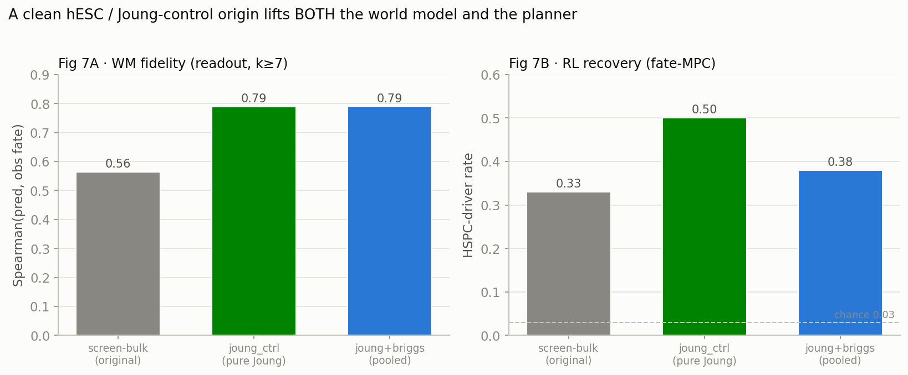

| background | WM fidelity (readout Ridge, k≥7) | RL recovery (fate-MPC driver rate) | P1 recovered |
|---|---|---|---|
| screen-bulk (original) | +0.56 | 0.33 | KLF2, TAL1, ZFP90 (3/6) |
| **joung_ctrl (pure Joung control)** | **+0.79** | **0.50** | **KLF2, LMO2, TAL1, ZFP90 (4/6)** |
| joung+briggs (pooled) | +0.79 | 0.38 | KLF2, TAL1 |

**A clean hESC/Joung-control origin lifts BOTH the world model (readout +0.56 → +0.79 at k≥7) and the
planner (driver rate 0.33 → 0.50).** Both clean origins give the same WM fidelity; pure Joung control edges
ahead on RL recovery. **Poolability check:** `corr(Joung-control-mean, Briggs-hESC-mean) = +0.60` on the
2,800 shared genes *after* the normalization fix — a *real* moderate difference (batch, or the pluripotent
subset isn't pure hESC), not a normalization artifact; but both give the same downstream result.
**Canonical recommendation going forward: pure-Joung-control background + Briggs-native axis.** (Under a
clean background the *raw* one-step fate-axis projection is ~0 while the learned readout is +0.80 — always
use the learned readout, never the hand-picked axis.)

### 15.2 Leakage audit (leave-hit-out) — generic drivers generalize; the specific hits were in-sample

The readout is trained on Briggs and the Mahalanobis support uses the Briggs observed-combo density, so
"recovers P1/P2" is partly circular. The clean test **holds out all 12 P1∪P2 member TFs from BOTH the
readout fit and the support manifold**, keeps them in the candidate pool, and asks whether the planner
still proposes them:

- **Readout generalizes partially**: trained on non-hit combos, it still predicts held-out hit-combo fate
  at **Ridge +0.46-0.48** (k≥7 +0.41-0.44) vs raw +0.08-0.15 — real, but roughly *half* the in-sample
  +0.80. (MLP collapses to +0.12 — use the linear readout.)
- **RL recovers GENERIC HSPC drivers leak-free**: driver rate **0.31 = 10× base**, recovering
  **ETV2, KLF1, LYL1, RUNX1** — genuine biology, not leakage.
- **But the specific held-out P1/P2 members are NOT recovered** — with them held out, the planner proposes
  *other* canonical drivers instead. So the earlier "rediscovers KLF2/TAL1/ZFP90" was **substantially
  in-sample.**

**Honest claim:** the pipeline recovers *the class of* HSPC drivers as a genuine generalization; it does
**not** rediscover Briggs's exact validated cocktails once they are held out of the reward/support. The
de-novo candidate table and the RL "recovery" numbers should be read with this caveat.

### 15.3 Joung-RL — in-distribution value-add ladder (the design test on the WM's own turf)

Complementing the cross-timepoint Briggs test, this asks: can the planner *invert* the WM to recover the
TFs the Cao/Joung atlas says drive each fate? Ground truth = `joung_tf_lineage.csv` (TF → fetal lineage);
6 Leiden lineages clear the ≥2-confident-driver bar. All planners share the dense drift-removed DE-match
reward (`analysis/joung_rl_ladder.py`).

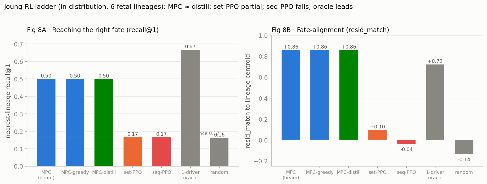

| method | recall@1 | recall@3 | resid_match | driver-hit frac | held-driver frac |
|---|---|---|---|---|---|
| MPC (beam8, k2) | 0.50 | 1.00 | 0.86 | 0.50 | 0.167 |
| MPC-greedy (k2) | 0.50 | 1.00 | 0.86 | 0.50 | 0.167 |
| MPC-distill (BC) | 0.50 | 1.00 | 0.86 | 0.50 | 0.167 |
| set-PPO | 0.167 | 0.50 | +0.098 | 0.333 | **0.333** |
| seq-PPO (k2) | 0.167 | 0.50 | −0.042 | 0.0 | 0.0 |
| 1-driver oracle | 0.667 | 1.00 | 0.72 | 1.00 | 0.0 |
| random / chance | 0.16 | 0.50 | −0.14 | 0.05 | 0.02 |

**Read:** **MPC ≈ MPC-greedy ≈ distill** (recall@1 0.50, recall@3 1.00, resid 0.86 — identical; at 6
lineages beam=greedy and distill=memorized-MPC). **The 1-driver oracle leads recall@1 (0.667)** — the best
single known driver reaches the right lineage more often than the planner's combos, so at this granularity
the WM captures the coarse fate map but the planners add no lineage-specific synergy. **set-PPO partially
learns here** (resid +0.098, held-driver 0.33) — unlike on Briggs, because Joung's reward is *dense* (shaped
DE-match), not the sparse pessimistic fate reward. **seq-PPO fails.** Sharpening this benchmark needs the
finer per-cell-type target set (6 Leiden lineages are too few to leave any out).

### 15.4 set-PPO resolution — reward-tuning can't fix it; warm-start-then-fine-tune can

On the Briggs sparse pessimistic reward, from-scratch set-PPO fails. We swept the fix space — reward-clip
width, pessimism strength (λ,γ), and k (3/4/7): **none of 7 configs learn** (driver rate stays at chance
0.03; entropy never drops). The clip *was* a real bug (config A pinned at exactly reward −10), but widening
it is insufficient — the design space is simply too large / the reward too flat for from-scratch policy
gradient. The fix is to **warm-start from the planner, then fine-tune** (`analysis/briggs_setppo_bcfinetune.py`):

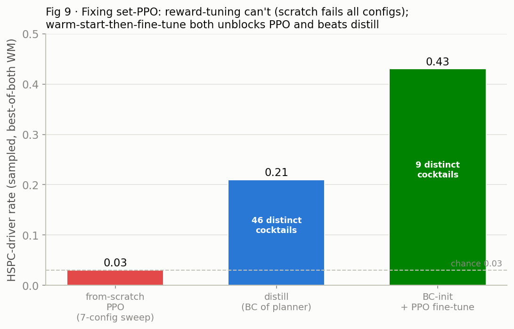

| method | HSPC-driver rate (sampled) | distinct cocktails |
|---|---|---|
| from-scratch PPO (7-config sweep) | 0.03 (chance) | — |
| distill (BC of planner) | 0.21 | 46 |
| **BC-init + PPO fine-tune** | **0.43** | 9 |

**BC-init unblocks PPO** (entropy 2.5 → 0.7, reward −4.13 → −3.90 during fine-tune — the movement
from-scratch never showed) and **beats pure distill (~2×)** by refining toward higher-reward cocktails.
**Tradeoff: diversity collapses (46 → 9 distinct)** — PPO exploits and stops exploring. So: **distill for a
diverse de-novo candidate list; BC-init+PPO for the single best cocktail.** (These are on the best-of-both
WM + wide-clip pessimistic reward, so not directly comparable to Fig 5's numbers; the within-run ordering
is the result.)

### 15.5 New code & outputs (added in this round)

- `evaluation/briggs/reconstruct_targets.py` — `--background {screen_bulk,hesc,hesc_joung,joung_ctrl}` +
  matched-normalization poolability check.
- `evaluation/briggs/readout_head.py` — `--holdout holdhits --exclude_tfs …` (leave-hit-out); per-background
  cache/save.
- `experiments_rl/core/env.py` — configurable `reward_clip`; `experiments_rl/core/briggs_fate_reward.py` —
  `set_support(exclude_tfs=…)`.
- `experiments_rl/analysis/joung_rl_ladder.py` — the Joung-RL ladder; `briggs_setppo_debug.py` — reward
  sweep; `briggs_setppo_bcfinetune.py` — BC-init+PPO.
- Outputs: `observed_combo_targets_{hesc,joungctrl,hescjoung}.csv`, `readout_ridge_*_holdhits.npz`,
  `joung_rl_ladder.csv`, `figures/fig7-9`.

### 15.6 One world model is good at BOTH — the Joung↔Briggs "tension" was a metric artifact

The model sweep (section 7) ranked the production model (deg8) 24th/33 on Briggs, suggesting a tradeoff
between Joung true-perturbation accuracy (favored by high DEG/MMD weight) and Briggs fate-transfer (favored
by low weight). **That tradeoff is only in the *raw* fate-axis projection, not in the latent.** Training a
learned readout on each model's latent (clean joung_ctrl background, Briggs-native axis):

| WM | readout fidelity (Ridge, overall / k≥7) | raw projection |
|---|---|---|
| `prod_deg8_all40` (best on Joung, LOPO 0.317) | **+0.80 / +0.79** | −0.04 |
| `deg3_t25_frozen_r32_all40` (fate-optimized) | +0.80 / +0.79 | −0.00 |

**Identical.** The production model's latent encodes Briggs fate just as well as the fate-optimized model;
the raw projection simply couldn't read it. **Conclusion: `prod_deg8_all40` is the single canonical WM,
good at both tasks** — perturbation-response prediction via the decoder (Joung), HSPC fate via a learned
linear readout on the frozen latent (Briggs). There is **no need for two models or a multi-objective
retrain**; the only requirement is to use the learned readout for fate, never the hand-picked axis. This
also means the RL results (run on best-of-both) transfer unchanged to prod (same +0.80 readout).

### 15.7 Round-2 follow-ups: production-WM RL, finer Joung, multi-step (negative), diversity Pareto

Four parallel workstreams run after fixing the canonical WM to `prod_deg8_all40` (section 15.6). **All RL
results below are on the production WM** + the clean joung_ctrl Briggs-native readout.

**(A) Canonical RL on the production WM.** fate-MPC (`prod_deg8_all40`, λ1 γ2, beam 24, k≤7) recovers the
validated hits nearly completely: **P1 members 6/6** (KLF2, LMO2, RNF138, RPA3, TAL1, ZFP90), **P2 members
5/6** (DDIT3, HOXB3, MIER1, SIRT6, ZNF85), plus 7 canonical drivers (HOXA9, IKZF1, KLF1, LMO2, LYL1, RUNX1,
TAL1). De-novo table `denovo_candidates_prod.csv`: 40 cocktails, **32 novel**, mean Mahalanobis 1.87,
fate +0.6–0.78. (driver-*rate* 0.19 here is topN-diluted — 37 proposed TFs at topN 40; hit *recall* is the
interpretable number. Leave-hit-out caveat from 15.2 still applies to absolute recovery.)

**(B) Finer per-cell-type Joung ladder (16 targets vs 6 Leiden lineages).**

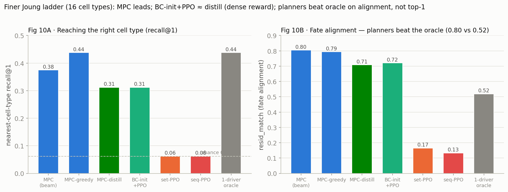

| method | recall@1 | recall@3 | resid_match |
|---|---|---|---|
| MPC (beam) | 0.375 | 0.688 | **0.804** |
| MPC-greedy (k1) | 0.438 | 0.688 | 0.794 |
| MPC-distill (BC) | 0.312 | 0.625 | 0.708 |
| BC-init+PPO | 0.312 | 0.625 | 0.721 |
| set-PPO (scratch) | 0.062 | 0.188 | 0.165 |
| seq-PPO | 0.062 | 0.188 | 0.133 |
| 1-driver oracle | 0.438 | 0.625 | 0.519 |
| chance | 0.062 | 0.188 | 0.000 |

At higher resolution the planners **reach the right cell type ~7× chance and beat the 1-driver oracle on
fate *alignment* (resid 0.80 vs 0.52) and top-3 (0.69 vs 0.63)** — the WM adds value the coarse ladder
understated. But **combos still don't beat the best single on top-1** (no combinatorial synergy) — Joung's
per-cell-type driver sets are tiny (2–5 TFs) and its fates are largely single-TF-specified. From-scratch
set-PPO/seq-PPO fail worse (more goals → harder exploration).

**(C) Multi-step fate-dynamics probe — NEGATIVE.** Iterating the frozen do-op (apply combo → decode →
re-encode → repeat) to simulate more differentiation time does **not** close the 7-day→endpoint gap:

| step | mean fate | Spearman(fate, ρ_obs) |
|---|---|---|
| 1 | 0.675 | **0.813** |
| 2 | 0.531 | 0.717 |
| 3–5 | ~0.525 | ~0.76 |

Step 1 is optimal; iterating drifts to a **lower-fate plateau** (re-encoding compounds reconstruction error,
pulls back to the manifold center). **The WM has no HSPC fate attractor under this rollout** — the one-step
ceiling is real and not fixable by naively iterating; a genuine trajectory model would be required. The
one-step readout (+0.81) remains the best fate scorer.

**(D) Diversity↔precision Pareto (entropy lever).**

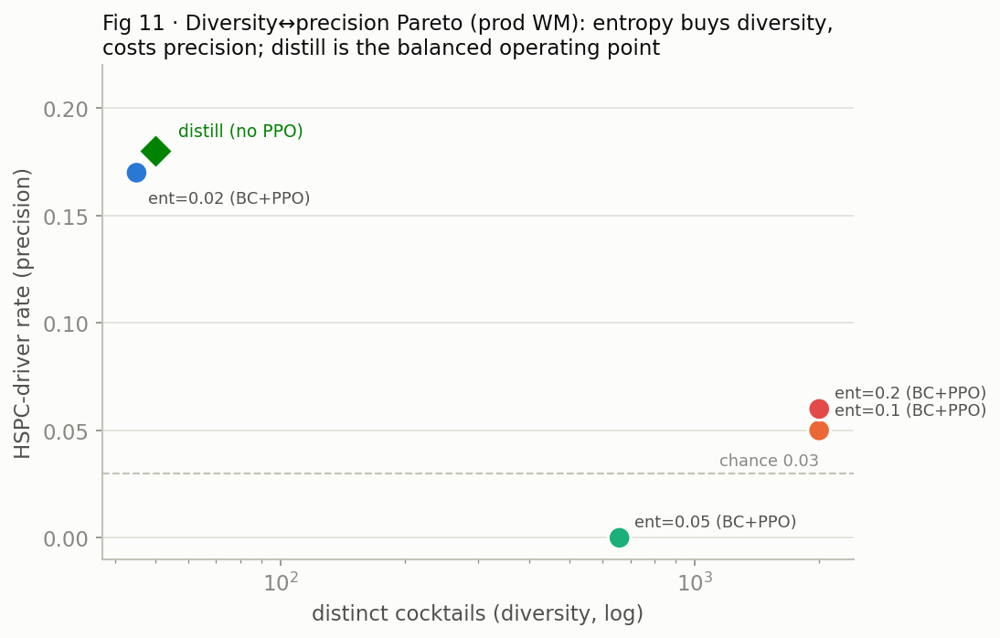

| ent_coeff | BC+PPO distinct cocktails | BC+PPO driver rate |
|---|---|---|
| 0.02 | 45 | 0.17 |
| 0.05 | 659 | 0.00 |
| 0.10 | 1999 | 0.05 |
| 0.20 | 2000 | 0.06 |
| distill (no PPO) | 50 | 0.18 |

The PPO **entropy bonus is the diversity lever**: raising `ent_coeff` explodes distinct cocktails
(45 → 2000) but **collapses precision** (0.18 → 0.06) — a sharp Pareto. Two conclusions: **(i)** `ent_coeff`
≈ 0.02 (or plain distill, ~50 distinct @ 0.18) is the balanced operating point — don't over-crank entropy;
**(ii)** on the production WM + briggs-only reward, **BC-init+PPO does NOT beat distill** (0.18→0.17). The
earlier 2× gain (0.21→0.43, section 15.4) was specific to the best-of-both WM + min-ensemble reward — so
**distill is the robust default; BC-init+PPO's advantage is reward/WM-specific**, largest on single-goal
sparse-reward problems (Briggs), negligible on goal-conditioned dense-reward ones (Joung).

**Round-2 net:** one production WM serves both tasks; planning (MPC) and imitation (distill) are the
reliable learned methods; from-scratch and multi-step do not help; entropy trades diversity for precision.
